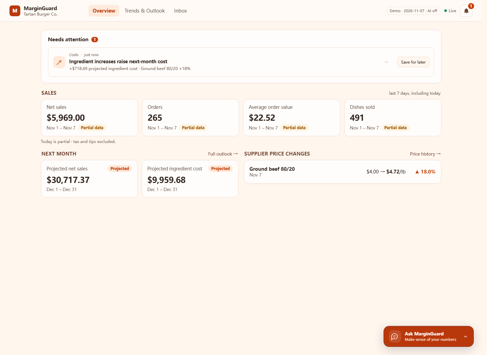
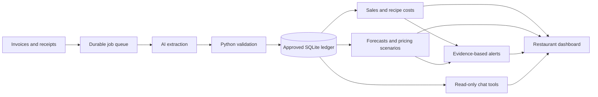
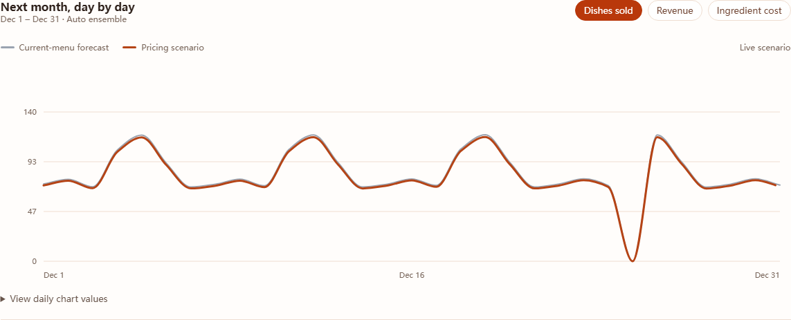

# MarginGuard

**An AI financial watchdog for independent restaurants.**

**Top 5 team in People's Choice · NOVA Hackathon 2026 · Carnegie Mellon University**

Built for the DoorDash Back of House track; developed further after the hackathon.

MarginGuard connects supplier invoices, sales receipts and recipes to show where ingredient costs are rising, how sales are changing, and what next month might look like. It maintains approved records as documents arrive, calculates financial figures in Python, and surfaces evidence-linked alerts without waiting for the owner to ask.

[](https://codespaces.new/MichaelfromSBS/MarginGuard?quickstart=1)



## Try it

### In your browser

1. Click **Open in GitHub Codespaces** above and create the codespace. A GitHub account with Codespaces access is required.
2. Wait for the initial setup to install dependencies and prepare the sample restaurant. This can take a few minutes.
3. Open **Ports → MarginGuard (8000) → Open in Browser** if it does not open automatically.

The dev container prepares and starts the application automatically. If startup is interrupted, inspect `/tmp/marginguard-demo.log` and run `python scripts/demo.py --no-browser` in the terminal after stopping any existing demo process. See [GitHub's port-forwarding guide](https://docs.github.com/en/codespaces/developing-in-a-codespace/forwarding-ports-in-your-codespace).

### On your computer

Install **Python 3.11+**, **Node.js 22.12+**, npm and Git, then run:

```bash
git clone https://github.com/MichaelfromSBS/MarginGuard.git
cd MarginGuard
python scripts/demo.py
```

The launcher installs dependencies into `.venv`, builds the website, imports the fictional restaurant, prepares forecasts and an example alert, and opens **http://127.0.0.1:8000**. On Windows, you can also double-click **Try MarginGuard.cmd** after downloading/extracting the repository. Use `python3` if that is your system's Python command.

Press **Ctrl+C** to stop the API and worker. If port 8000 is occupied, use `python scripts/demo.py --port 8016`. Later launches reuse installed dependencies and preserve demo interactions, including saved/resolved alerts.

### A two-minute tour

- **Overview:** inspect sales, projected ingredient costs and the supplier-price increase. Click an alert for the full reason; choose **Save for later** to move it out of Overview.
- **Trends & Outlook:** compare forecast models, hover over daily predictions, and change cost pass-through or assumed price sensitivity. Charts and calculations update automatically. Ingredient price records expand on click.
- **Inbox → Notifications:** open a saved alert, inspect its sources, then **Resolve** it. The bell and new-alert notifications also lead here.
- **Inbox → Documents:** review imported invoices and their extracted fields. Enable imported history receipts to inspect the sales records behind the dashboard.

**No API key is required for this tour.** The demo uses explicit, pre-approved fictional fixtures and a fixed business date of **November 7, 2026**, so the historical dataset remains useful when opened later. It runs in the separate `data/visitor-demo/` directory and does not overwrite your normal database or `.env`. Imported fixtures are labeled; they are not presented as results of a live AI extraction.

**Live invoice/receipt extraction and owner chat require your own OpenRouter key.** They are unavailable in the key-free demo; dashboards, forecasts, pricing scenarios and alert review work without them.

## The problem and solution

Restaurant records are scattered across supplier PDFs, customer receipts and menu recipes. An owner can see revenue while missing the connection between a more expensive ingredient and a dish's replacement cost. A static spreadsheet also needs someone to notice and investigate the change.

MarginGuard turns incoming documents into a maintained ledger, connects ingredient prices to recipe economics, and provides a shared view of current performance and future assumptions. Alerts link back to the records that support them, and the owner can ask follow-up questions about the data.

| Capability | What it delivers |
| --- | --- |
| Document ingestion | PDF/PNG/JPEG invoices and receipts, structured AI extraction, catalog matching, arithmetic/unit checks, review states and duplicate protection |
| Automatic updates | Durable processing jobs, an independent worker, folder monitoring and immediate observed sales/cost updates after approval |
| Business analytics | Sales by day, dish and channel; effective ingredient prices; recipe replacement costs; explicit partial-day coverage |
| Adaptive forecasting | Per-dish/channel demand models selected or blended through chronological validation, with daily next-month projections and held-out evaluation |
| Pricing scenarios | Ingredient changes → recipe costs → proposed menu prices → assumed demand response → projected revenue and ingredient consumption |
| Proactive alerts | Combined ingredient/projected-cost increases and next-day reports of unusually low sales, each with measured facts and sources |
| Grounded owner chat | AI-planned read-only queries, Python-calculated answers, evidence links and conversational explanations |

## How it works



**AI reads and explains; Python owns the numbers.** Extraction converts document language into typed records. Validation checks totals, quantities, unit conversions, business keys and source evidence before approval. Chat maps questions to a bounded set of validated database tools; financial answers use retrieved calculations rather than model-invented figures. Follow-up explanations are separately labeled.

The worker scans the configured local `inbox/` folder, handles queued uploads, refreshes forecasts and runs deterministic anomaly checks. Alerts and notifications stay inside the website. Saving an alert persists its state; resolving it retains its evidence in the database.

### Forecasting

Auto compares weekday averages, a prior-week seasonal baseline, recency-weighted weekdays, regularized Poisson regression and Poisson gradient boosting. It selects or blends candidates separately for each dish/channel and forecast lead range using chronological validation. Coverage gates, a weekday baseline anchor and long-horizon shrinkage limit unsupported extrapolation. A separate seven-day holdout evaluates the full selection procedure.

Ingredient-price changes flow through recipe costs. The pricing planner applies an explicitly **assumed price elasticity** to proposed menu prices and adjusts demand, revenue and ingredient requirements. This coefficient is not learned from the short demo history. Scenarios do not change actual menu prices or the ledger.

The included corpus is fictional and short; it does not establish real-world forecasting accuracy. See the [forecasting guide](docs/forecasting.md) for algorithms, validation, performance measurements and limitations.



## Enable live AI

Setup creates `.env` from [.env.example](.env.example) if it does not already exist. Add your key and a model ID from [OpenRouter's catalog](https://openrouter.ai/models):

```dotenv
AI_MODE=openrouter
OPENROUTER_API_KEY=your-key-here
OPENROUTER_MODEL=your-compatible-model-id
```

Stop the demo and restart with:

```bash
python scripts/demo.py --live-ai
```

Choose a model with compatible structured-output support; photo extraction also needs image input. Live calls use your provider credits. Keys stay on the server and are excluded from Git.

Try uploading the supplied [invoice](demo_data/live_demo/2_invoice_RF-20261107-004.pdf), [receipt](demo_data/live_demo/1_receipt_TB-20261107-001.pdf) or [receipt photo](demo_data/live_demo/3_receipt_TB-20261107-002_photo.png). The first two are already present in the populated demo, so exact duplicates return the existing record. Use the photo to exercise a fresh live extraction. Ask questions such as “Why did ingredient costs increase?”, “What were sales last week?”, “Which dishes cost the most to make?” and “What does that mean?”

Chat can report and explain approved data, assumptions and saved forecasts. It cannot edit the ledger, change prices, resolve alerts, send messages or execute arbitrary SQL. Failed or unsupported requests produce explicit errors rather than silently fabricating results.

## Technology

| Layer | Stack |
| --- | --- |
| Frontend | React 19, TypeScript, Vite, custom responsive SVG charts |
| API and validation | Python 3.11+, FastAPI, Pydantic, Decimal arithmetic |
| Storage and processing | SQLite, versioned migrations, transactional approval, persisted jobs, independent Python worker |
| AI | OpenRouter over asynchronous HTTP; structured extraction and bounded read-only query planning |
| Forecasting | NumPy, scikit-learn, regularized Poisson regression, Poisson gradient boosting and adaptive statistical ensembles |
| Verification | pytest, Node's test runner, production builds and recorded desktop/mobile browser checks |

## Development

```bash
python scripts/setup.py --forecasting
npm run dev
```

The development launcher starts the API, worker and Vite frontend. Open **http://127.0.0.1:5173**; API documentation is at **http://127.0.0.1:8000/docs**. It uses the normal `.env` configuration rather than the visitor demo's isolated settings. A fresh normal database is empty until explicitly configured or seeded; the visitor launcher above is the easiest populated starting point.

Python and `.env` changes require restarting services; frontend edits reload automatically. Ports 8000 and 5173 must be free. If PowerShell blocks `npm.ps1`, use `npm.cmd`. The Windows launcher uses a selector event loop to avoid the Proactor `WinError 64` listener failure.

For the smaller dependency set, omit `--forecasting`; statistical forecasts remain available while optional scientific models are excluded or report their missing dependency. Environment variables override `.env`. The standard paths are `data/marginguard.db`, `data/uploads/` and `inbox/`. Dates use the restaurant's configured timezone and forecast training excludes incomplete days.

Run the release checks with:

```bash
python scripts/check.py
```

This runs isolated backend tests, frontend tests, a production build and Python dependency checks. GitHub Actions runs the same checks on Windows and Linux. To regenerate the API contract and response examples, use `.venv/Scripts/python.exe scripts/export_contract.py` on Windows or `.venv/bin/python scripts/export_contract.py` on macOS/Linux. The exporter uses an isolated fixture database.

### API and repository guide

The [interactive API docs](http://127.0.0.1:8000/docs) and [OpenAPI export](docs/openapi.json) describe the complete contract. Primary routes cover `/api/documents`, `/api/sales`, `/api/dashboard`, `/api/forecasts`, `/api/alerts` and `/api/chat`. Money and quantities are decimal strings; list responses include pagination. The API's existing `acknowledged` state and `/acknowledge` endpoint represent **Save for later** in the interface.

```text
backend/marginguard/   Ingestion, validation, analytics, models, chat and alerts
backend/worker.py     Durable queue and automatic processing loop
frontend/src/mg/      Restaurant screens, charts, chat and notification workflow
scripts/             Setup, visitor demo, development and verification launchers
tests/               Isolated backend acceptance and regression tests
demo_data/           Fictional history, source documents and negative controls
examples/            API responses, extraction examples and forecasting results
docs/                Architecture details, development history and review guides
.devcontainer/       GitHub Codespaces visitor setup
.github/workflows/   Windows/Linux verification
```

## Project context and limits

MarginGuard placed among the **top five teams in People's Choice at NOVA Hackathon 2026** at CMU. The restaurant-specific ingestion, analytics, chat and monitoring workflow grew out of the DoorDash Back of House challenge. Subsequent work added adaptive forecasting, price-sensitive scenarios, faster calculations and interface refinements. [PREEXISTING.md](PREEXISTING.md) records the generic preparation completed before the event; [the progress record](docs/progress.md) distinguishes implementation and validation stages.

This is a working local prototype and reproducible demonstration, not a production restaurant accounting service. Ingredient projections describe modeled consumption and replacement costs, not audited COGS, cash purchases or net profit. Forecasts depend on coverage and planning assumptions. Uploaded documents require validation; some cases enter review. The app does not include production authentication, POS/delivery-platform integrations or automatic business-email access. The worker's local folder watcher is implemented; mailbox authorization and email-attachment ingestion remain [planned work](docs/post-hackathon-plan.md).

All bundled business records are fictional. No API key, owner database or uploaded private document is included in this repository.

Additional material: [presentation notes](docs/presentation-summary.md), [sample-data contract](docs/sample-data-contract.md), and [dataset guide](demo_data/README.md).
